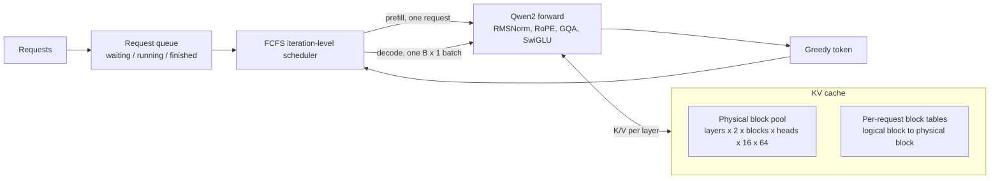
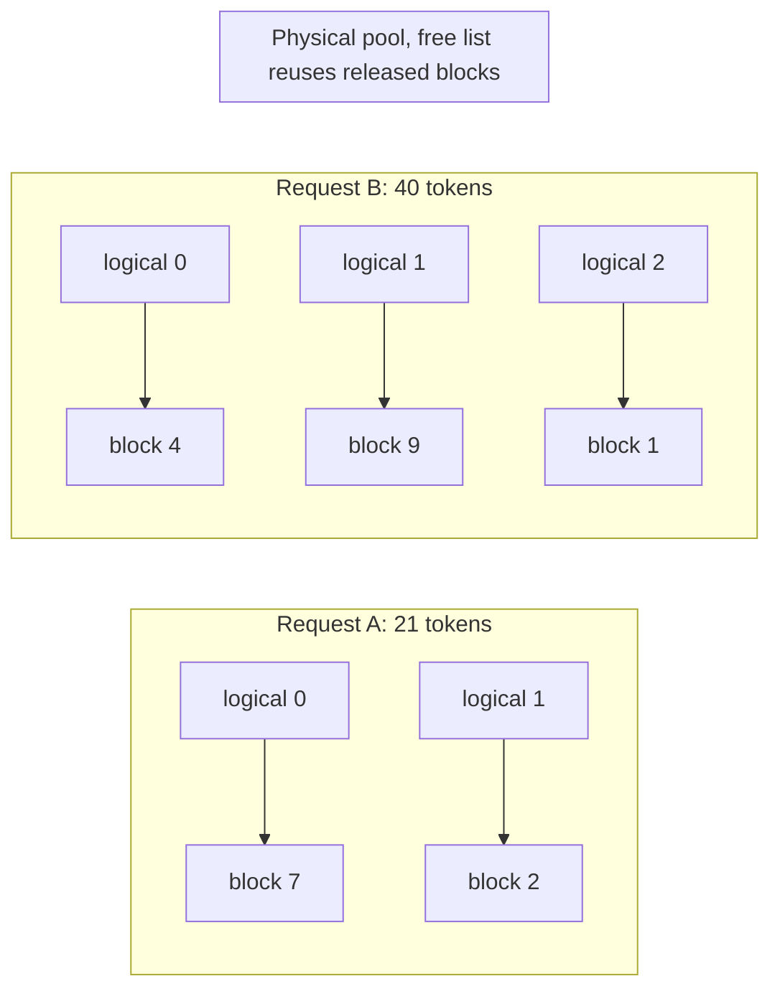

# TinyInfer

A single-GPU LLM inference engine for Qwen2.5-0.5B, built to find out **where inference
time and memory actually go**. TinyInfer owns the model forward pass, the KV cache, the
scheduler, and the benchmarks; Hugging Face supplies only the tokenizer, the weights, and a
reference to check every result against.

It is an experimental system, not a vLLM replacement: each capability lands behind a
correctness gate first, then gets measured on reproducible workloads.

## Highlights

- **Own Qwen2 forward pass**: RMSNorm, RoPE, grouped-query attention, and SwiGLU written as
  plain tensor functions. All 24 layers match Hugging Face, and greedy output is identical
  token for token on the real model.
- **Continuous batching over a paged KV pool**: requests of different lengths decode together
  in a single `[B, 1]` forward pass, reading their KV from shared fixed-size blocks.
- **Measured, not assumed**: 210 benchmark records show that batching 16 short requests
  gives 4.3× the single-request throughput. They also show that, with the current
  dense-gather cache, batching long prompts is *slower* than running them one at a time.
- **Correctness first**: every path is checked token for token against Hugging Face. BF16
  divergence under batching was traced to exact logit ties and is recorded, not hidden.

## Milestones

| Gate | Milestone | Status | Evidence |
|---|---|---|---|
| G0.5 | Reproducible WSL2 + CUDA + Triton environment | Done | [report](docs/G0_5_REPORT.md) |
| G1 | Explicit prefill/decode loop matching `model.generate()` | Done | [report](docs/G1_REFERENCE_RUNTIME_REPORT.md) |
| G2-BD | Heterogeneous batched decode on a shared paged KV pool | Done (local) | [report](docs/G2_BD_REPORT.md) |
| G2-P1 | Batching throughput baseline, 210 records | Done (local + CI) | [report](docs/G2_P1_REPORT.md) |
| G3 | TinyInfer-owned Qwen2 forward pass | Done (local) | [design](docs/superpowers/specs/2026-09-27-owned-qwen2-forward-design.md), [shapes](docs/QWEN2_SHAPES.md) |
| C / D | Attention reads paged KV directly; re-measure with roofline | Next | |
| G2-P2 | On-demand block allocation; reserved vs. paged memory | Planned | |
| G4 | Profile-guided Triton paged decode kernel | Planned | |
| Report | 4–6 page technical report and demo | Planned | |

Full plan and gate definitions: [docs/PROJECT_PLAN.md](docs/PROJECT_PLAN.md).

## Architecture



Each scheduler iteration admits waiting requests and prefills them, then runs **one**
decode forward over every running request, appends one token each, and releases the
blocks of any request that finished.

## KV cache

Decode reuses every earlier token's keys and values, so the KV cache is the main memory
cost that grows with context. For Qwen2.5-0.5B in BF16:

```text
bytes per token = 2 (K and V) x 24 layers x 2 KV heads x 64 dims x 2 bytes = 12,288
```

Grouped-query attention is why this is small: 14 query heads share 2 KV heads, so the cache
is 1/7 the size it would be with full multi-head attention.

TinyInfer has three cache paths, each checked against Hugging Face:

| Path | Layout | Used for |
|---|---|---|
| Hugging Face `DynamicCache` | Library-managed | G1 reference |
| `ContiguousKV` | `[layers, 2, batch, kv_heads, tokens, head_dim]`, sized per request | Owned forward pass |
| `PagedKVCache` | Shared pool of 16-token blocks + per-request block tables | Continuous batching |

In the paged cache, a request's logical token positions map to physical blocks through its
block table, so requests of any length share one pool without contiguous reservations:



To batch requests of different lengths, each decode step gathers every row's blocks into a
left-padded dense tensor, gives each row its own RoPE position, and masks the padding.

**What the measurements say about this design** ([G2-P1 report](docs/G2_P1_REPORT.md)):

- The gather is a Python loop over blocks. It adds about **0.64 ms per block per decode
  step**, so a 612-token prompt decodes 2.7× slower than the Hugging Face reference.
- Blocks are still reserved for `prompt + max_new_tokens` at admission, so the paged
  cache does not yet save memory over a contiguous reservation.

Both limitations are the next milestones. Stage C makes attention read blocks directly
instead of copying them; G2-P2 adds on-demand allocation and compares memory use.

## Key results

RTX 4080 SUPER, Qwen2.5-0.5B, BF16, greedy decoding; median of 5 runs after 3 warm-ups.

| Workload | HF, one at a time | TinyInfer batched | Batched TPOT |
|---|---:|---:|---:|
| 1 short prompt | 63.5 tok/s | 53.0 tok/s | 18.8 ms |
| 16 short prompts | 63.8 tok/s | **274.6 tok/s** | 54.7 ms |
| 8 × 612-token prompts | 59.1 tok/s | **35.7 tok/s** | 219.4 ms |

- Single-request decode reaches only about 9% of the GPU's memory bandwidth, so launch and
  scheduling overhead dominate, not weight reads.
- Batching cuts queueing: with 16 short requests, the median time to first token falls from
  4.2 s (one at a time) to 0.14 s.

## Correctness policy

- Every optimized path must match a deterministic reference before it is measured.
- Hidden states and logits are compared layer by layer before comparing generated text.
- Every result records the git revision, hardware, software versions, workload, warm-up,
  repetitions, and raw data.
- Single-request paths must match Hugging Face exactly. Batched paths may diverge only
  where two tokens tie within one BF16 unit, and every divergence is recorded. Different
  batch shapes use different GEMM kernels, which can break an exact tie either way.

## Repository map

```text
tinyinfer/model/       owned Qwen2: spec, weights, ops, forward pass, KV protocol, greedy
tinyinfer/cache/       paged block pool, block tables, batched cache view
tinyinfer/scheduler/   request queue and FCFS batching engine
tinyinfer/runtime/     Hugging Face loader and reference generation
tinyinfer/profiling/   timers and benchmark record schemas
benchmarks/            benchmark CLIs, workloads, divergence diagnosis
docs/                  plan, reports, designs, tensor shape table, raw results
```

## Quickstart

CPU only (unit tests use a tiny random Qwen2, no download):

```bash
python -m venv .venv
python -m pip install -e ".[dev,inference]"
python -m pytest -m "not gpu and not model"
python -m ruff check . && python -m mypy
```

GPU (Linux or WSL2, Qwen2.5-0.5B already cached):

```bash
uv sync --locked --extra dev --extra inference --extra kernels
HF_HUB_OFFLINE=1 python -m pytest tests/integration -m "gpu and model" -v
HF_HUB_OFFLINE=1 python benchmarks/bench_phase2.py --output /tmp/g2p1/raw.jsonl \
  --kv-pool-tokens 8192 --warmup-runs 3 --repetitions 5
python benchmarks/summarize_phase2.py --input /tmp/g2p1/raw.jsonl --output /tmp/g2p1/summary.md
```

Regenerate the tensor shape table after changing the forward pass:

```bash
python scripts/render_qwen2_shapes.py
```

## Further reading

- [Tensor shape table](docs/QWEN2_SHAPES.md): every step of one prefill and one decode.
- [Beginner guide](docs/BEGINNER_GUIDE.md) and [Phase 1 learning guide](docs/PHASE1_LEARNING_GUIDE.md) (Chinese).
- [Phase 2 status](docs/PHASE2_STATUS.md) and [G2-P1 runbook](docs/G2_P1_RUNBOOK.md).

## Non-goals

HTTP serving, multiple model families, sampling beyond greedy, quantization, distributed
inference, speculative decoding, prefix caching, and production features are out of scope.

## License

MIT
